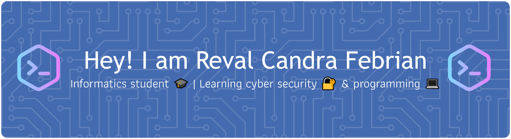

  
  
  

---

## 🚀 About Me

- 🎓 Informatics Engineering student
- 🔭 Currently exploring **cyber security** fundamentals
- 💻 Learning **programming languages**, starting with **C++**, through small practice programs
- 🔐 Interested in how systems are attacked, and how to defend them
- 🌱 Learning by doing, one commit at a time
- 📫 Reach me: 

---

## 🛠️ Tech Stack & Tools

  
  

  

---

## 🎯 Learning Goals

- [x] Learn C++ basics
- [ ] Build more C++ practice projects
- [ ] Understand core cyber security concepts
- [ ] Try beginner-friendly CTF challenges
-  [ ] Write a cyber security project proposal / report

---

## 📊 GitHub Stats

  
  

---

